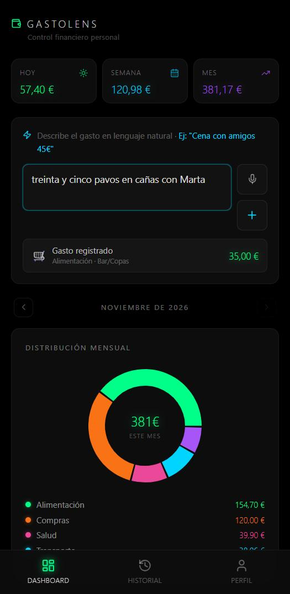
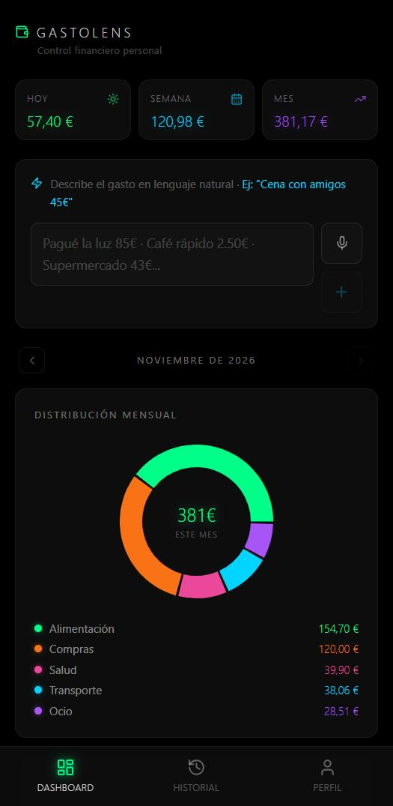
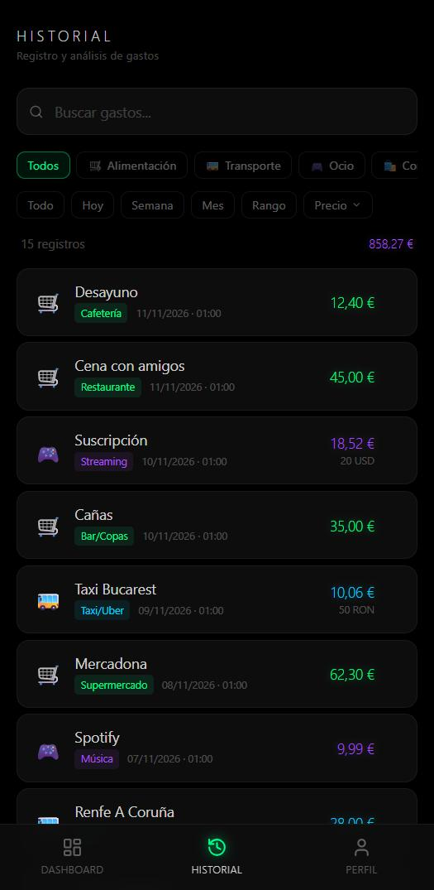

<div align="center">

# Gastolens

**Personal finance without the friction.**
Logging an expense should cost what it costs to say it out loud. Type it or
speak it, and the app does the rest.

[**gastolens.vercel.app →**](https://gastolens.vercel.app)


🇪🇸 [Versión en español](README.es.md)

</div>

---

<table>
<tr>
<td width="33%"><br><sub><b>The parser</b> — <i>"treinta y cinco pavos en cañas"</i> becomes 35.00 €, Food · Bar/Drinks, before you press anything.</sub></td>
<td width="33%"><br><sub><b>Dashboard</b> — today, this week, this month, and where the money went.</sub></td>
<td width="33%"><br><sub><b>History</b> — 20 USD and 50 RON land as euros, with the original amount kept.</sub></td>
</tr>
</table>

<sub>Screenshots taken against sample data.</sub>

## The idea

Every budgeting app asks for an amount, a category and a date in three separate
fields. Most people give up by week two. Gastolens accepts one sentence:

> *"dinner with friends 45 euros"*

and extracts **amount → 45**, **currency → EUR**, **category → eating out**,
**date → today**. By voice through the Web Speech API, or typed. Zero
infrastructure, installable as a PWA, works offline and syncs across devices.

## The parser

A hand-written parser, with no dependency on anybody else's API:

- **Numbers written as words** — *"treinta y cinco pavos"* resolves to 35.00.
- **Slang for money** — *pavos*, *pelas*, *cholos*, *telas*, *eurazos* all mean
  euros.
- **Three currencies**, converted to euros at the 2024 annual average rate:
  EUR, Romanian **lei** (RON, 0.2012 €) and US **dollars** (USD, 0.9259 €) —
  a side effect of spending an Erasmus year in Bucharest.
- **Category inference** from a hand-built taxonomy of Spanish merchants and
  everyday words (`src/utils/categoryConfig.js`), so *Alcampo* is groceries and
  *Alsa* is transport without being told.

## Importing a bank statement

Drop in a CSV or Excel export (BBVA and Revolut formats are mapped) and the
transactions go to **Gemini 1.5 Flash in batches** — one call per batch, with
the category taxonomy passed as the response schema so the model cannot invent
labels. If there is no API key, or the call fails, the **local rules classify
instead**. The import never hard-depends on the model being available.

The app also registers as a **Web Share Target**, so a statement can be shared
straight from a banking app into Gastolens.

## Where it ended up

The finance engine written here — the parser, the category taxonomy, the date
helpers and the metrics — was later reused as a native module inside
[**Rentlog**](https://github.com/JaimeMoralesCastro/rentlog), where hosts log
property expenses the same way.

## Running it locally

```bash
npm install
npm run dev
```

Supabase is used for authentication and sync. Copy `.env.example` to `.env` and
fill in:

```
VITE_SUPABASE_URL=
VITE_SUPABASE_ANON_KEY=
```

The Gemini key is entered by the user inside the app, not committed — without
it, imports fall back to the local rules.

```bash
npm run build       # generates the PWA icons and builds
```

## Layout

```
src/
├── utils/
│   ├── nlpParser.js        natural-language and voice expense parser
│   ├── categoryConfig.js   category taxonomy and merchant dictionary
│   ├── geminiClassifier.js batch classification with local fallback
│   └── dateHelpers.js
├── components/   expense input, history, detail, charts, bank import, auth
├── hooks/        useExpenses, useSpeechRecognition, useLocalStorage
├── contexts/     AuthContext (Supabase)
└── lib/          Supabase client
public/           manifest, service worker, generated icons
```

## License

[MIT](LICENSE) © Jaime Morales Castro
